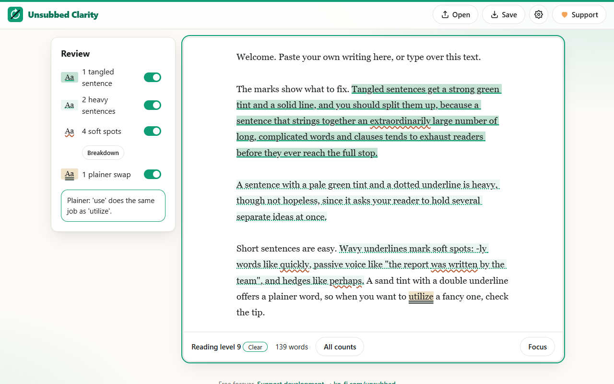

# Unsubbed Clarity

**A free alternative to Hemingway Editor.** Runs entirely in your browser. No account, no subscription, no tracking. Your files never leave your device.

**Use it now:** https://unsubbed.github.io/clarity

## What it does
- Marks tangled and heavy sentences, using a public readability formula
- Flags soft spots (-ly words, passive voice, hedges) and suggests plainer words
- Colors plus underline patterns, so marks read without color
- Focus mode hides everything for distraction-free typing (Ctrl+. or Cmd+.)
- Open and save your work as ordinary files on your own device

## Privacy
Everything happens on your device. The app makes no outside network requests: no analytics, no ads, no server. Your work is stored in this browser until you clear it, and you can save a copy at any time.

## Run it yourself
It's a plain web page with no build step. Download this repository and serve the folder with any static web server (for example `npx serve .`), then open the address it prints. To check the text engine, run `node analyze.test.mjs` (it prints `ok`).

## Known issues
- **Very long texts are slower.** At around 20,000 words, the page pauses for about half a second after each burst of typing while it re-checks the text.
- **The tip box is untested in Firefox and Safari.** The tip that appears when your cursor sits on a marked word has only been tested in Chromium-based browsers (Chrome, Edge). It should work elsewhere, but if it doesn't update, please open an issue.

---

Free forever. Support development → [ko-fi.com/unsubbed](https://ko-fi.com/unsubbed) · New app every day → [@unsubbed_org on X](https://x.com/unsubbed_org)

## License & contributing
Unsubbed apps are licensed under the [GNU AGPL-3.0](LICENSE). If you share a modified version or run it as a service, you must publish your changes under the same license.

Improvements are welcome. See [CONTRIBUTING.md](CONTRIBUTING.md) to send your changes back to the main version.
